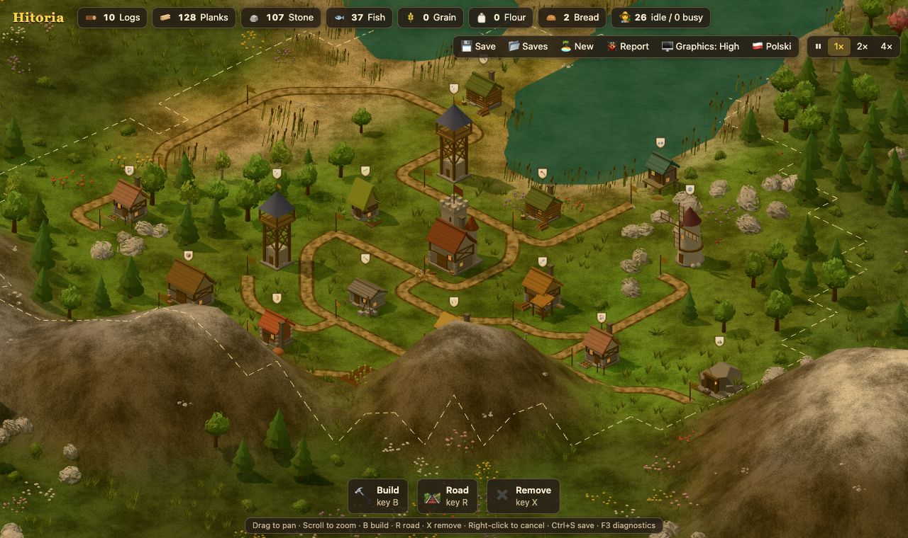

# Hitoria

A peaceful 2.5D settlement builder for the browser, inspired by *The Settlers*.

**Play it in your browser:** https://koszcz.github.io/hitoria/



## How to play

You start with a headquarters (HQ), some goods and 18 settlers. Your goal is to grow a working
economy. Nobody attacks you.

1. **Place a woodcutter's hut.** Press `B` to open the build menu and pick the woodcutter's hut.
   Then click open grass near trees.
2. **Check its road.** The game lays a road to your nearest flag when one fits. If it can't, press
   `R`, click the hut's flag, then click a flag that is joined to the HQ. Right-click to stop
   drawing.
3. **Watch it get built.** A builder walks to the site. Carriers bring planks from the HQ along the
   road. Once it is built, a woodcutter moves in and starts felling trees.
4. **Grow your economy.**
   - A forester (`2`) plants new trees, so the woodcutter never runs out.
   - A quarry (`3`) next to boulders makes stone.
   - A sawmill (`4`) turns logs into planks. You need planks for every new building.
   - A lookout tower (`5`) expands your land, so you have room for more.
   - Fishers, farms, mills and bakeries make food. Houses turn food into new settlers.
   - Your starting land always has a mountain for a stone mine and a bay for a fisher.

Every building needs a road to the HQ. Without one, no goods arrive and the builder or worker
waits. A sign with a crossed-out road floats over any building that has no road. Click a building
to see what it is doing and what it is waiting for.

### Controls

| Action | Input |
| --- | --- |
| Move the map | Drag |
| Zoom | Scroll |
| Open the build menu | `B`, or the Build button |
| Pick a building straight away | `1`–`9` |
| Place several of the same building | Shift-click |
| Draw roads | `R` |
| Remove a road or a lone flag | `X` |
| Cancel | Right-click or Esc |
| Pause | Space |
| Save | Ctrl+S (or Cmd+S) |
| Show live diagnostics | F3 |

If something looks wrong, click **Report**. It saves a problem report to `reports/`.

## Design pillars

- **No raids, ever.** Nobody attacks you. The challenge is logistics: keeping goods flowing,
  planning space, and growing your economy.
- **Watch it live.** Every log is carried by a visible settler. You can see why a building is
  idle (no trees in range, waiting for logs, no free carrier).
- **Grow by building, not by fighting.** Lookout towers expand your land instead of military
  buildings.

## Running it

Needs [Bun](https://bun.sh). The only library is [Three.js](https://threejs.org), for the 3D view.

```bash
bun install      # first time only
bun run dev      # http://main.localhost:5173  (add ?seed=123 to start a fixed map fresh)
bun run play     # http://play.localhost:5174  (a copy to play on, see below)
bun run build    # static build in dist/
bun test         # tests, kept next to the code they test
bun run readme:shot   # take the screenshot at the top of this README again
```

## Running several copies

You can work on several branches at once, each in its own git worktree. Each copy of the dev
server gets its own address, named after its branch:

| Branch | Address |
| --- | --- |
| `main` | http://main.localhost:5173 |
| `claude/new-roads` | http://claude-new-roads.localhost:5173 |

To use it:

1. Run `bun run dev` in each worktree. It prints the address to open.
2. Open http://localhost:5173 to see every copy that is running.

Things to know:

- Each address has its own save, because browsers keep local storage per address.
- Crash and problem reports go to `reports/` in the worktree that served the page.
- To pick a different name, set `DEV_NAME`, for example `DEV_NAME=try2 bun run dev`.
- Port 5173 must be free for the first copy you start. If that copy stops, another running copy
  takes over the port within a few seconds.

## Playing while other branches change

Use `bun run play` when you want to play without interruptions. Other sessions can merge into
`main` or stop their servers, and your game keeps running.

The command:

1. Makes a worktree next to this folder, named `hitoria-play`, the first time you run it.
2. Moves that worktree to the newest commit on `main`.
3. Starts it at http://play.localhost:5174, on its own port.

To get new features, stop the command and run it again. Your saves stay, because the address
stays the same. Saves from other addresses, such as http://main.localhost:5173, do not appear here.

## Saving

Saves live in your browser's local storage. You can keep as many as the storage holds.

- **Save** (or Ctrl+S) stores the game you are playing. The first time, it makes a new save named
  after the island. After that, it writes over that same save.
- **Saves** opens a list of every save. From there you can load a save, save as a new one, write
  over a save, delete one, or change how often the game autosaves.
- **Autosave** runs every minute by default, and when you close the tab. You can also set it to
  every 5 minutes, or turn it off. The game keeps the 3 newest autosaves and writes over the oldest.
- **New** starts a fresh island. It makes an autosave of the old island first.
- Opening the page continues from your newest save.

The save keeps the map, buildings, roads, flags and every good. It does not keep where settlers are.
After a load, everyone starts in the HQ and walks back to their post. Goods a settler was holding go
back to their building or flag, so nothing is lost.

## Graphics

The **Graphics** button in the menu sets how the game is drawn. Click it to go through the choices.

- **Auto** is the default. It starts on a level that suits your device: High on a computer, Medium
  on a phone or tablet. If the game runs slowly, it lowers the level while you play and tells you.
  If the game then runs smoothly for a while, it tries one level higher, but never one that was
  already too slow. The browser remembers the level it settled on.
- **Low**, **Medium** and **High** stay as you set them. Low turns off shadows and draws fewer
  pixels. High draws soft shadows at full sharpness.

Press F3 to see the level, and how much the game draws each frame.

## Code map

| File | What it does |
| --- | --- |
| `src/world.ts` | Seeded map generation: island, forests, boulders, mountains, and the mountain and bay every start gets |
| `src/game/` | Simulation: buildings, roads, settlers, carriers, food and saving |
| `src/path.ts` | A* pathfinding on the tile grid |
| `src/render/` | Three.js 3D renderer: terrain, water, buildings, settlers, overlays. Keeps the isometric camera angle. `looks.ts` gives each building its body shape and colours |
| `src/quality/` | The graphics setting, and Auto, which lowers it when frames are slow |
| `src/art.ts` | The game's colours and light in one place: sky, sun, land, water and trees |
| `src/ui.ts` | HUD and info panel |
| `src/buildmenu/` | The build menu |
| `src/saves.ts` | Save slots in the browser's local storage |
| `src/i18n.ts` | Translations |
| `src/main.ts` | Input, camera, fixed-step game loop |

## Current economy

- Woodcutter → logs → Sawmill → planks. A forester replants trees.
- A quarry breaks boulders into stone. A stone mine digs stone out of a mountain, and its miner
  eats fish or bread.
- Farm → grain → Mill → flour → Bakery → bread. A fisher catches fish.
- A house turns fish or bread into new settlers.
- A lookout tower expands your land.
- Goods are stored at the HQ and in storehouses.

Every building has a flag in front of its door. Goods only travel along roads between flags:
each road section has one carrier who passes goods from flag to flag, and a flag holds at most
8 goods, so busy roads back up. Long roads get extra flags every few tiles so more carriers share
the load. Settlers walk 1.5× faster on roads. A building that isn't connected to the HQ by road
gets no materials.

## Ideas

Ideas for the game, and what we build next, live in [ideas/](ideas/README.md).
